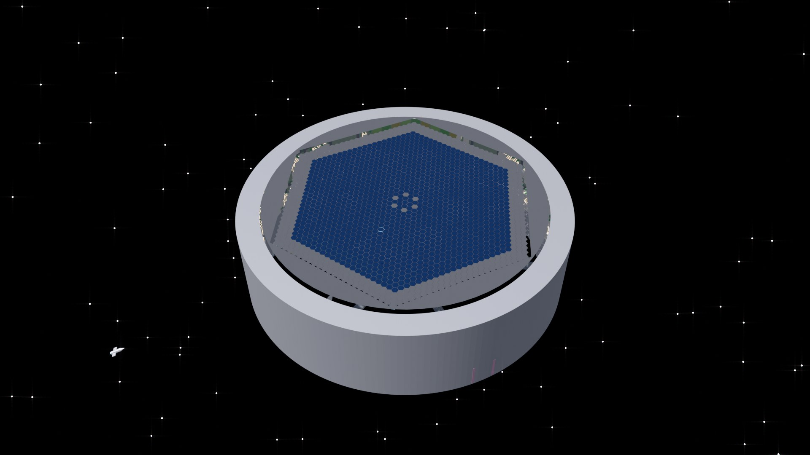

# Let's Structure the Universe of Videos and Podcasts

Material of the talk by **Tim Wittenborg**, project lead of the WissKomm Wiki, at the **NFDI Science Slam 2026** (5 November 2026): a camera ride through a space station that an AI agent built in Blender, step by step, under human direction. Motto: *My agent built this station. Going wild with AI. Carefully.*

The talk is part of [WissKomm Wiki](https://wisskomm.wiki), a library for scientific videos and podcasts. This repository keeps everything the talk produced, so others can look inside and learn from it.

**Start here:**

- [What went wrong with AI, and what we learned](lessons-learned/README.md): the book from museum room 5, our own rules for building with an agent, and what we kept forgetting
- [How the station was built](making-of/README.md): early grey boxes next to the final look, decisions, numbers
- [Explore the station room by room](station/README.md): every room and part with a picture, a Blender file and a glTF file
- [How we worked](process/README.md): the pipeline from story to rendered deck, the camera rules, the on-screen credits and how we worked with an AI agent, written so you can reproduce the workflow

## Contents

| Folder | What is in it |
|---|---|
| [making-of/](making-of/README.md) | How the station came to be: early grey boxes next to the final look, the decisions behind it, numbers |
| [lessons-learned/](lessons-learned/README.md) | The book from museum room 5 (incidents with AI, each with its sources), what we learned ourselves while building with an agent, and the rebound effect |
| [videos/](videos/README.md) | Recommended videos (links only) and earlier talks of this series |
| [station/](station/README.md) | The objects we built: one folder per room and part of the station, each with a README, a preview, a Blender file (`.blend`) and a glTF file (`.glb`), plus the whole station in one file; a few parts are left out for now (listed there) |
| [process/](process/README.md) | How the talk was made: pipeline, camera rules, credits overlay, working with an agent |
| [scripts/](scripts/README.md) | The Python scripts that generate the scene inside Blender, and their settings and layout data |
| [assets/](assets/README.md) | Third-party assets used while building (Poly Haven, linked) and references |
| [tools/](tools/README.md) | Small tools that made this repository (cutting the scene into modules, previews, link lists, checks) and the tools of the render and deck pipeline |
| [credits.md](credits.md) | Everyone whose work appears in the talk |

## Recording

The recording of the slam will be linked here once it is online.

## Acknowledgements

The WissKomm Wiki, the project this talk is about, is a project of Leibniz University Hannover (LUH), TIB – Leibniz Information Centre for Science and Technology, and BorgNetzWerk e.V., funded by FDM-NDS (2026 to 2028, [proposal](https://doi.org/10.5281/zenodo.18714623)) and startsocial.

The Lower Saxony Research Data Management Initiative (FDM-NDS) is a project of Hochschule.digital Niedersachsen (HdN). The state initiative is funded as part of zukunft.niedersachsen, a funding program run by the Lower Saxony Ministry of Science and Culture (MWK) and the Volkswagen Foundation.

BorgNetzWerk e.V. holds a startsocial scholarship for 2026/27. Thanks to everyone named on the partner wall in room 4 and in [credits.md](credits.md).

## Licence

Licence pending: no licence has been chosen yet, so all rights are reserved for now; see [LICENSE](LICENSE). Third-party works are not included here, only linked and credited.
