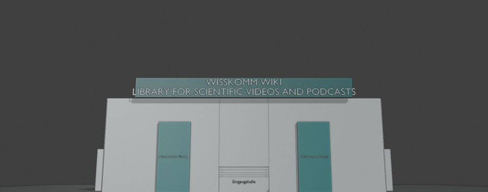
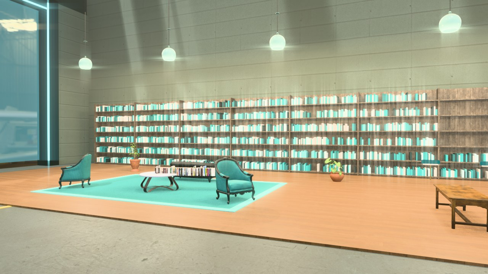
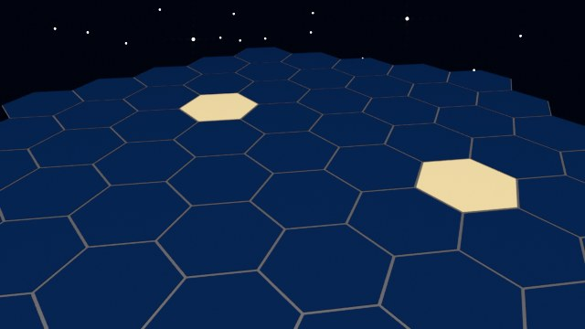
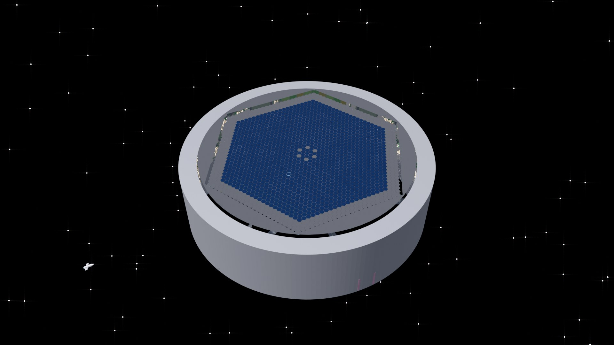
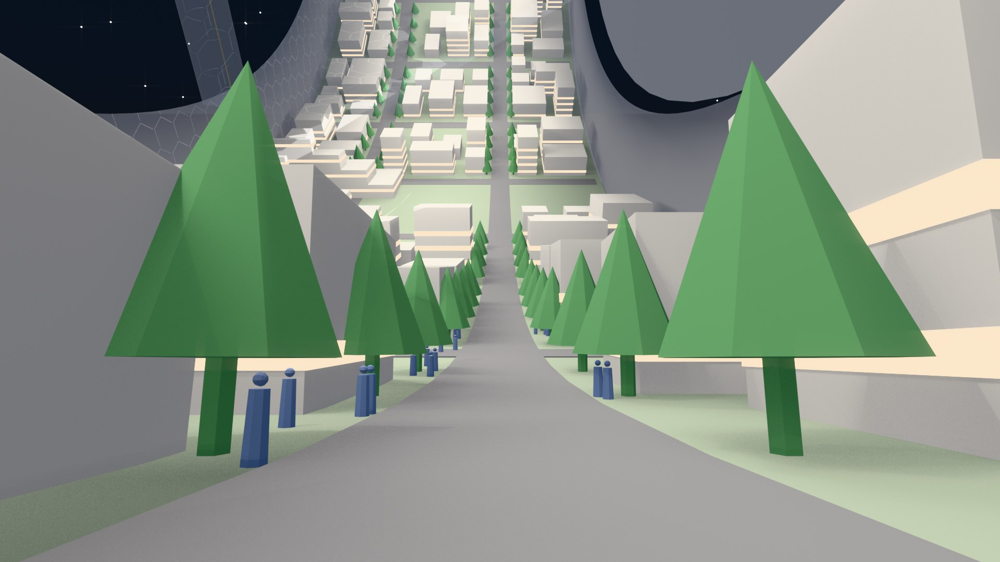
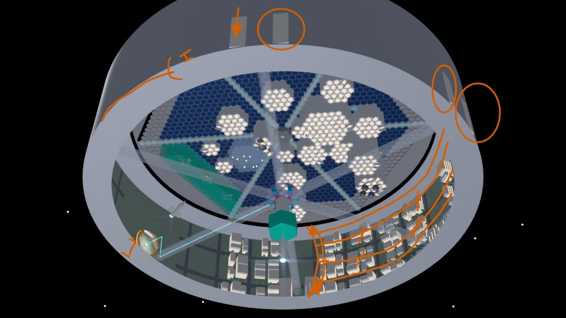

# Making of

The whole talk is one camera ride through a space station: a ring with a city and a museum, six spokes with lifts, and a hub at the axis with a lobby, a map room and the modules of a knowledge infrastructure. An AI agent (Claude) built the scene in Blender, entirely from Python scripts, in about nine days, while a human described, sketched, marked up renders and decided. Decisions were written down before they were built.

Why scripts and not a modelled scene? Because the agent can only change what it can write. The scene was rebuilt from the scripts on every run, so every change stayed traceable. For this repository the built scene was saved once and cut into modules (see [station/](../station/README.md)).

## Then and now

Early grey boxes next to what they became. Dates are when the picture was made.

| Then | Now |
|---|---|
|  27 Oct: the first library, still on Earth |  27 Oct: the library, furnished |
|  28 Oct: the collector, first sketch |  29 Oct: the turn from library to space station |

29 Oct: a street in the ring.

31 Oct: how decisions were made. Renders were marked up by hand and the marks went back to the agent as the next instructions.

## Decisions by topic

The design of the station rests on 43 recorded design questions, 32 of them decided by the time of the talk, grouped by topic: light, form, gravity and posture, views and windows, connections and paths, interiors, technology and safety, story and slam. Each one was asked with options, pros, cons and what the literature on space habitats says, then answered and recorded with the date. On top of that came 64 rounds of feedback on renders and rides. The decision log itself is part of the project's working material and not included here.

## Numbers

Counted on 4 November 2026; lower bounds, since unlogged runs are missing.

| | |
|---|---|
| Blender rendering | at least 48.7 hours |
| Dictated feedback | 64 dictations, 27,691 words |
| Prompts in all agent sessions of the project since 28 Oct, including other work | 651 prompts, 73,369 words, 87 sessions |
| Prompts in the sessions for this talk since 28 Oct (counting started a day after building began) | 148 prompts, 28,480 words, 23 sessions |

These numbers are part of the point: see [the rebound effect](../lessons-learned/README.md#the-rebound-effect).
