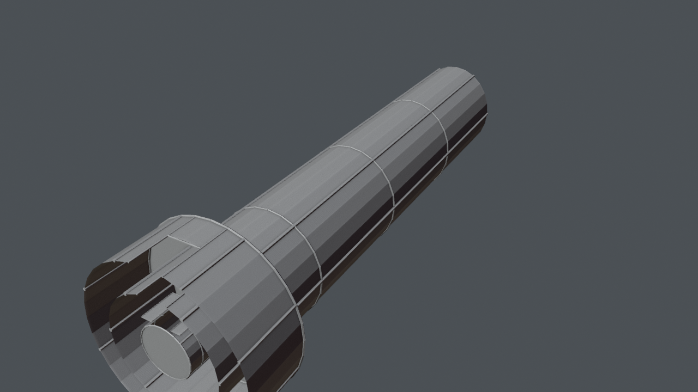

# Spoke elevator: tower, hall, cabin, doors, sign

*Preview with simple shading. Grey surfaces on panels mark images that are not included (see below).*

The lift that runs up a spoke from the ring to the hub: tower, hall, cabin with glass doors and its sign.

## Files

- [elevator.blend](elevator.blend) (0.2 MB): open in Blender 5.2 or newer (files saved in 5.2 do not open in 4.x; use the .glb there). The collection `elevator` can be appended or linked into another scene; reuse beyond viewing and study needs the licence, which is still pending (see [LICENSE](../../LICENSE)).
- [elevator.glb](elevator.glb) (0.2 MB): glTF binary for other tools and game engines; text objects and some materials are simplified by the exporter.

## Using it

- Positions are the station's coordinates in metres, so modules fit together again when you link several of them; [../station.blend](../station.blend) links all of them. Object origins sit at the station centre, not at the room: press Home (View All) to find the module, and use Object > Set Origin > Origin to Geometry before you move a part on its own.
- Light and sky are in [environment](../environment/README.md); link it as well, otherwise the module renders unlit.
- Object names are German, as the scene was built with German names; [manifest.json](../manifest.json) lists every object.

## What is inside

| Collection | Objects |
|---|---|
| `elevator.elevator` | 13 |
