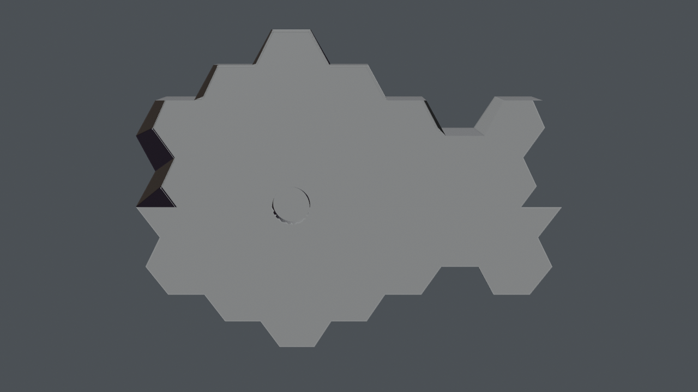

# Hub lobby, space bar, job board

*Preview with simple shading. Grey surfaces on panels mark images that are not included (see below).*

The lobby at the hub where the lift arrives, with handrails for zero gravity, the space bar and a job board.

## Files

- [hub_lobby.blend](hub_lobby.blend) (0.3 MB): open in Blender 5.2 or newer (files saved in 5.2 do not open in 4.x; use the .glb there). The collection `hub_lobby` can be appended or linked into another scene; reuse beyond viewing and study needs the licence, which is still pending (see [LICENSE](../../LICENSE)).
- [hub_lobby.glb](hub_lobby.glb) (0.8 MB): glTF binary for other tools and game engines; text objects and some materials are simplified by the exporter.

## Using it

- Positions are the station's coordinates in metres, so modules fit together again when you link several of them; [../station.blend](../station.blend) links all of them. Object origins sit at the station centre, not at the room: press Home (View All) to find the module, and use Object > Set Origin > Origin to Geometry before you move a part on its own.
- Light and sky are in [environment](../environment/README.md); link it as well, otherwise the module renders unlit.
- Object names are German, as the scene was built with German names; [manifest.json](../manifest.json) lists every object.

## What is inside

| Collection | Objects |
|---|---|
| `hub_lobby.job_board` | 2 |
| `hub_lobby.lobby` | 29 |
| `hub_lobby.space_bar` | 3 |

## From Poly Haven (not included)

Put these files into `station/textures/polyhaven/<asset>/` (download from the linked page, see [../../assets/README.md](../../assets/README.md)):

- [granite_tile](https://polyhaven.com/a/granite_tile): `granite_tile_diff_2k.jpg`
- [granite_tile](https://polyhaven.com/a/granite_tile): `granite_tile_nor_gl_2k.jpg`
- [granite_tile](https://polyhaven.com/a/granite_tile): `granite_tile_rough_2k.jpg`
- [painted_plaster_wall](https://polyhaven.com/a/painted_plaster_wall): `painted_plaster_wall_diff_2k.jpg`
- [painted_plaster_wall](https://polyhaven.com/a/painted_plaster_wall): `painted_plaster_wall_nor_gl_2k.jpg`
- [painted_plaster_wall](https://polyhaven.com/a/painted_plaster_wall): `painted_plaster_wall_rough_2k.jpg`
