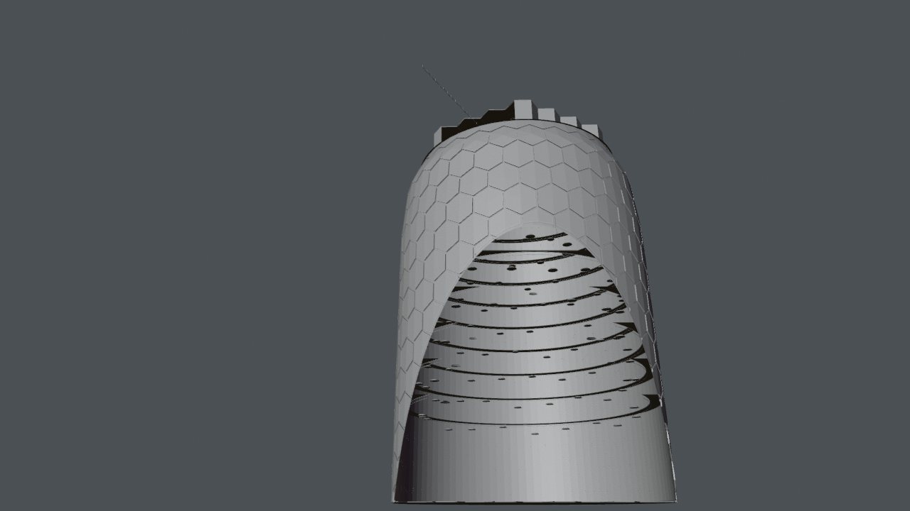

# Map room: funnel, star map

*Preview with simple shading. Grey surfaces on panels mark images that are not included (see below).*

The map room of the hub: a funnel of galleries under a glass roof and a star map where channels are suns and videos and podcasts are planets. The glowing globe above the star map in the talk is not included; only a hidden helper sphere marks its place.

## Files

- [hub_map_room.blend](hub_map_room.blend) (1.5 MB): open in Blender 5.2 or newer (files saved in 5.2 do not open in 4.x; use the .glb there). The collection `hub_map_room` can be appended or linked into another scene; reuse beyond viewing and study needs the licence, which is still pending (see [LICENSE](../../LICENSE)).
- [hub_map_room.glb](hub_map_room.glb) (7.1 MB): glTF binary for other tools and game engines; text objects and some materials are simplified by the exporter.

## Using it

- Positions are the station's coordinates in metres, so modules fit together again when you link several of them; [../station.blend](../station.blend) links all of them. Object origins sit at the station centre, not at the room: press Home (View All) to find the module, and use Object > Set Origin > Origin to Geometry before you move a part on its own.
- Light and sky are in [environment](../environment/README.md); link it as well, otherwise the module renders unlit.
- Object names are German, as the scene was built with German names; [manifest.json](../manifest.json) lists every object.

## What is inside

| Collection | Objects |
|---|---|
| `hub_map_room.globe` | 2 |
| `hub_map_room.room` | 19 |

## From Poly Haven (not included)

Put these files into `station/textures/polyhaven/<asset>/` (download from the linked page, see [../../assets/README.md](../../assets/README.md)):

- [metal_plate_02](https://polyhaven.com/a/metal_plate_02): `metal_plate_02_nor_gl_1k.jpg`
- [metal_plate_02](https://polyhaven.com/a/metal_plate_02): `metal_plate_02_rough_1k.jpg`
- [painted_plaster_wall](https://polyhaven.com/a/painted_plaster_wall): `painted_plaster_wall_diff_2k.jpg`
- [painted_plaster_wall](https://polyhaven.com/a/painted_plaster_wall): `painted_plaster_wall_nor_gl_2k.jpg`
- [painted_plaster_wall](https://polyhaven.com/a/painted_plaster_wall): `painted_plaster_wall_rough_2k.jpg`
- [wood_floor](https://polyhaven.com/a/wood_floor): `wood_floor_diff_2k.jpg`
- [wood_floor](https://polyhaven.com/a/wood_floor): `wood_floor_nor_gl_2k.jpg`
- [wood_floor](https://polyhaven.com/a/wood_floor): `wood_floor_rough_2k.jpg`
