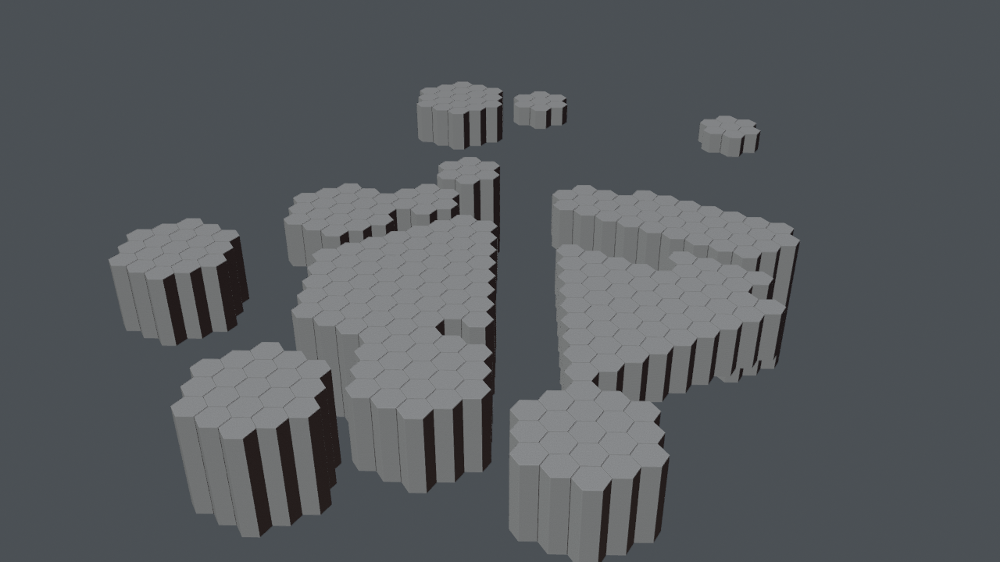

# Hub modules (one collection per module)

*Preview with simple shading. Grey surfaces on panels mark images that are not included (see below).*

The modules of the hub, one collection each: archive, coding room, event log, hall of memories, knowledge cluster, lab, meeting rooms, portal, reading room, recording studio, screening room, server hall, text chamber, transmitter, user interface, viewing room, workshop. Each module stands for one function of WissKomm Wiki.

## Files

- [hub_modules.blend](hub_modules.blend) (0.1 MB): open in Blender 5.2 or newer (files saved in 5.2 do not open in 4.x; use the .glb there). The collection `hub_modules` can be appended or linked into another scene; reuse beyond viewing and study needs the licence, which is still pending (see [LICENSE](../../LICENSE)).
- [hub_modules.glb](hub_modules.glb) (0.3 MB): glTF binary for other tools and game engines; text objects and some materials are simplified by the exporter.

## Using it

- Positions are the station's coordinates in metres, so modules fit together again when you link several of them; [../station.blend](../station.blend) links all of them. Object origins sit at the station centre, not at the room: press Home (View All) to find the module, and use Object > Set Origin > Origin to Geometry before you move a part on its own.
- Light and sky are in [environment](../environment/README.md); link it as well, otherwise the module renders unlit.
- Object names are German, as the scene was built with German names; [manifest.json](../manifest.json) lists every object.

## What is inside

| Collection | Objects |
|---|---|
| `hub_modules.archive` | 1 |
| `hub_modules.coding_room` | 1 |
| `hub_modules.event_log` | 1 |
| `hub_modules.hall_of_memories` | 1 |
| `hub_modules.knowledge_cluster` | 1 |
| `hub_modules.lab` | 1 |
| `hub_modules.meeting_rooms` | 1 |
| `hub_modules.portal` | 1 |
| `hub_modules.reading_room` | 1 |
| `hub_modules.recording_studio` | 1 |
| `hub_modules.screening_room` | 1 |
| `hub_modules.server_hall` | 1 |
| `hub_modules.text_chamber` | 1 |
| `hub_modules.transmitter` | 1 |
| `hub_modules.user_interface` | 1 |
| `hub_modules.viewing_room` | 1 |
| `hub_modules.workshop` | 1 |

## From Poly Haven (not included)

Put these files into `station/textures/polyhaven/<asset>/` (download from the linked page, see [../../assets/README.md](../../assets/README.md)):

- [metal_plate_02](https://polyhaven.com/a/metal_plate_02): `metal_plate_02_nor_gl_1k.jpg`
- [metal_plate_02](https://polyhaven.com/a/metal_plate_02): `metal_plate_02_rough_1k.jpg`
