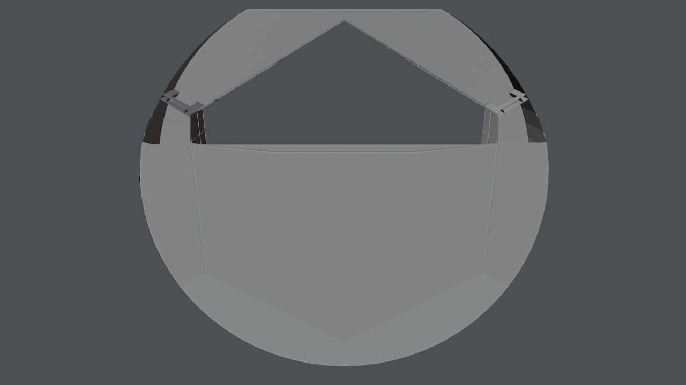

# Museum building: walls, floors, gates, doors, sign, lights

*Preview with simple shading. Grey surfaces on panels mark images that are not included (see below).*

The round museum building in the ring: walls and floors of all rooms (one object across the rooms), the window band, the entrance gate, inner doors, the sign and the lights.

## Files

- [museum_building.blend](museum_building.blend) (0.2 MB): open in Blender 5.2 or newer (files saved in 5.2 do not open in 4.x; use the .glb there). The collection `museum_building` can be appended or linked into another scene; reuse beyond viewing and study needs the licence, which is still pending (see [LICENSE](../../LICENSE)).
- [museum_building.glb](museum_building.glb) (0.4 MB): glTF binary for other tools and game engines; text objects and some materials are simplified by the exporter.

## Using it

- Positions are the station's coordinates in metres, so modules fit together again when you link several of them; [../station.blend](../station.blend) links all of them. Object origins sit at the station centre, not at the room: press Home (View All) to find the module, and use Object > Set Origin > Origin to Geometry before you move a part on its own.
- Light and sky are in [environment](../environment/README.md); link it as well, otherwise the module renders unlit.
- Object names are German, as the scene was built with German names; [manifest.json](../manifest.json) lists every object.

## What is inside

| Collection | Objects |
|---|---|
| `museum_building.lights` | 1 |
| `museum_building.shell` | 27 |
| `museum_building.sign` | 9 |

## From Poly Haven (not included)

Put these files into `station/textures/polyhaven/<asset>/` (download from the linked page, see [../../assets/README.md](../../assets/README.md)):

- [painted_plaster_wall](https://polyhaven.com/a/painted_plaster_wall): `painted_plaster_wall_diff_2k.jpg`
- [painted_plaster_wall](https://polyhaven.com/a/painted_plaster_wall): `painted_plaster_wall_nor_gl_2k.jpg`
- [painted_plaster_wall](https://polyhaven.com/a/painted_plaster_wall): `painted_plaster_wall_rough_2k.jpg`
- [white_plaster_02](https://polyhaven.com/a/white_plaster_02): `white_plaster_02_diff_2k.jpg`
- [white_plaster_02](https://polyhaven.com/a/white_plaster_02): `white_plaster_02_nor_gl_2k.jpg`
- [white_plaster_02](https://polyhaven.com/a/white_plaster_02): `white_plaster_02_rough_2k.jpg`

## Left out on purpose

These are works by others or illustrations we cannot license. Materials keep their image slot: a picture saved as `station/withheld/<file name>` appears in place. Left-out objects are empties named `Withheld <name>` at the same place.

- `entrance_logo.png`: WissKomm Wiki logo (Gerrit Hansen)
- `entrance_logo_side.png`: WissKomm Wiki logo (Gerrit Hansen)
