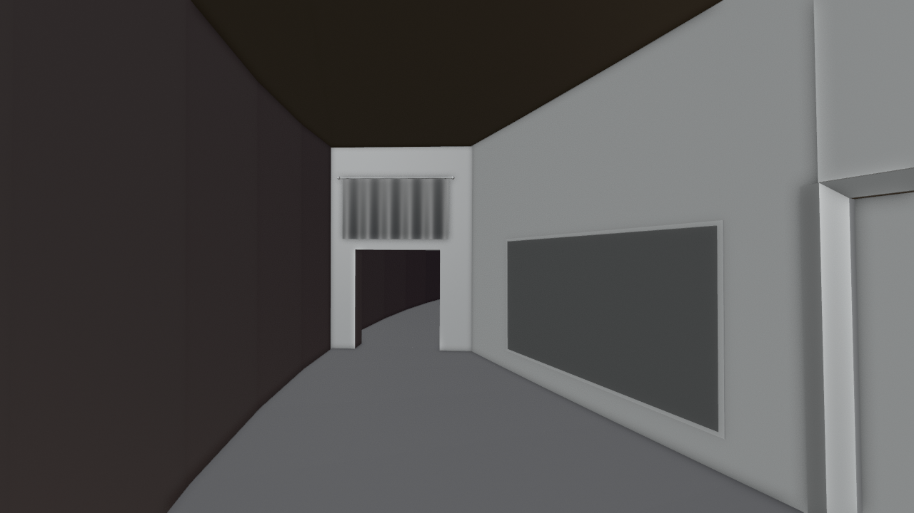

# Museum room 1: opening

*Preview with simple shading. Grey surfaces on panels mark images that are not included (see below).*

Opening: the first room after the entrance, with the title of the exhibition on a fabric banner.

## Files

- [museum_room_1.blend](museum_room_1.blend) (0.1 MB): open in Blender 5.2 or newer (files saved in 5.2 do not open in 4.x; use the .glb there). The collection `museum_room_1` can be appended or linked into another scene; reuse beyond viewing and study needs the licence, which is still pending (see [LICENSE](../../LICENSE)).
- [museum_room_1.glb](museum_room_1.glb) (63 kB): glTF binary for other tools and game engines; text objects and some materials are simplified by the exporter.

## Using it

- Positions are the station's coordinates in metres, so modules fit together again when you link several of them; [../station.blend](../station.blend) links all of them. Object origins sit at the station centre, not at the room: press Home (View All) to find the module, and use Object > Set Origin > Origin to Geometry before you move a part on its own.
- Light and sky are in [environment](../environment/README.md); link it as well, otherwise the module renders unlit.
- Object names are German, as the scene was built with German names; [manifest.json](../manifest.json) lists every object.

## What is inside

| Collection | Objects |
|---|---|
| `museum_room_1.room_1` | 6 |

## From Poly Haven (not included)

Put these files into `station/textures/polyhaven/<asset>/` (download from the linked page, see [../../assets/README.md](../../assets/README.md)):

- [rough_linen](https://polyhaven.com/a/rough_linen): `rough_linen_nor_gl_1k.jpg`
- [rough_linen](https://polyhaven.com/a/rough_linen): `rough_linen_rough_1k.jpg`

## Left out on purpose

These are works by others or illustrations we cannot license. Materials keep their image slot: a picture saved as `station/withheld/<file name>` appears in place. Left-out objects are empties named `Withheld <name>` at the same place.

- `foyer_banner.png`: shows the WissKomm Wiki logo by Gerrit Hansen
- `title_slide.png`: shows a Borgi figure by Gerrit Hansen
