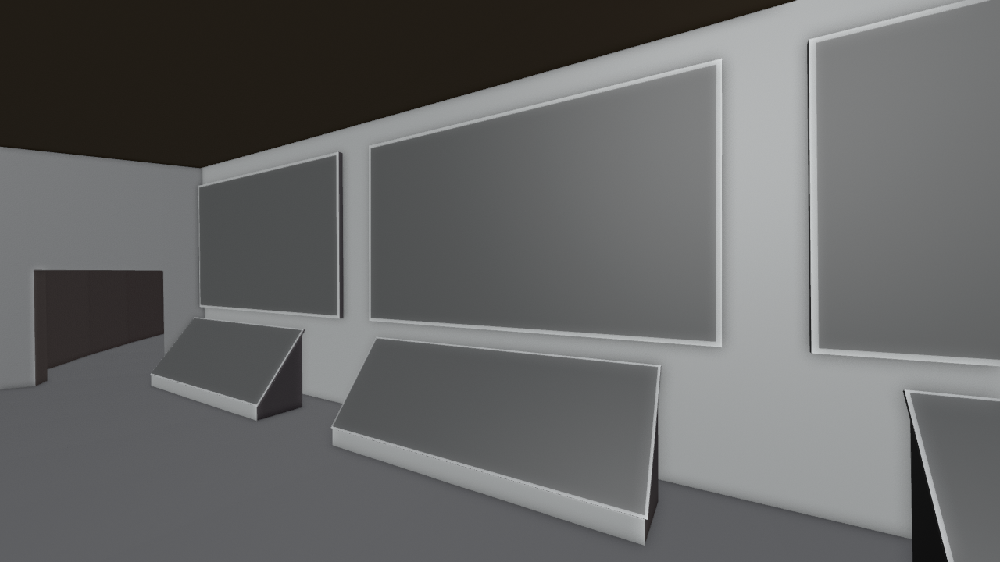

# Museum room 3: three screens

*Preview with simple shading. Grey surfaces on panels mark images that are not included (see below).*

Three screens: three lecterns, each showing a video that inspired the talk (data analysis of YouTube, a graph of Wikipedia, which channels people watch), with a short card that connects it to this work.

## Files

- [museum_room_3.blend](museum_room_3.blend) (0.1 MB): open in Blender 5.2 or newer (files saved in 5.2 do not open in 4.x; use the .glb there). The collection `museum_room_3` can be appended or linked into another scene; reuse beyond viewing and study needs the licence, which is still pending (see [LICENSE](../../LICENSE)).
- [museum_room_3.glb](museum_room_3.glb) (37 kB): glTF binary for other tools and game engines; text objects and some materials are simplified by the exporter.

## Using it

- Positions are the station's coordinates in metres, so modules fit together again when you link several of them; [../station.blend](../station.blend) links all of them. Object origins sit at the station centre, not at the room: press Home (View All) to find the module, and use Object > Set Origin > Origin to Geometry before you move a part on its own.
- Light and sky are in [environment](../environment/README.md); link it as well, otherwise the module renders unlit.
- Object names are German, as the scene was built with German names; [manifest.json](../manifest.json) lists every object.

## What is inside

| Collection | Objects |
|---|---|
| `museum_room_3.room_3` | 21 |

## Left out on purpose

These are works by others or illustrations we cannot license. Materials keep their image slot: a picture saved as `station/withheld/<file name>` appears in place. Left-out objects are empties named `Withheld <name>` at the same place.

- `adumb_wikipedia_graph.jpg`: still of a third-party video
- `adumb_wikipedia_graph_lectern.png`: still of a third-party video
- `not_david_nerds.jpg`: still of a third-party video
- `not_david_nerds_lectern.png`: still of a third-party video
- `ultralativ_youtube_de.jpg`: still of a third-party video
- `ultralativ_youtube_de_lectern.png`: still of a third-party video
