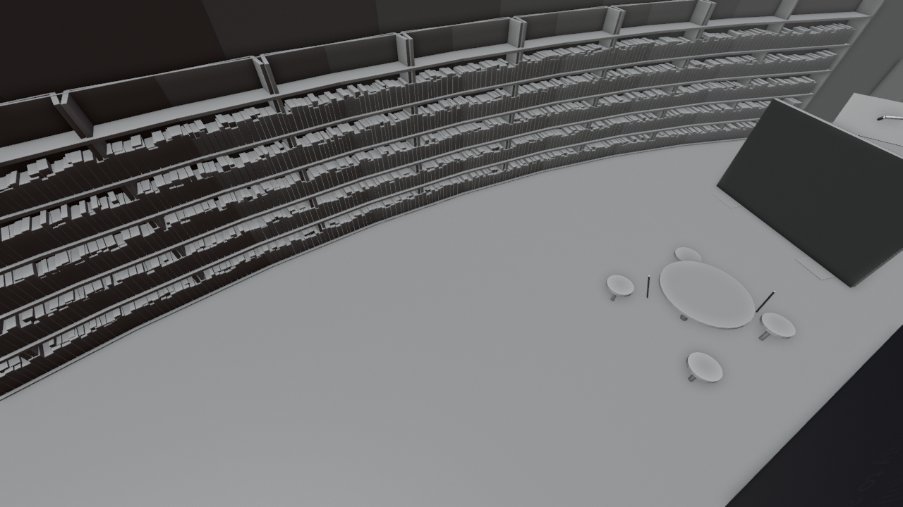

# Museum room 5: lessons learned

*Preview with simple shading. Grey surfaces on panels mark images that are not included (see below).*

Lessons learned: a library with the book of AI incidents on a lectern, shelves, a reading table, a chair station with a video, a tablet, a room divider about the reverse centaur, a window onto a crowd of agents and a terminal. The text on the wall quotes Joseph Browning verbatim, from his post of 10 July 2024 (https://twitter.com/Joseph_Browning/status/1811022092176933325): "The underlying purpose of AI is to allow wealth to access skill while removing from skill the ability to access wealth."

## Files

- [museum_room_5.blend](museum_room_5.blend) (0.5 MB): open in Blender 5.2 or newer (files saved in 5.2 do not open in 4.x; use the .glb there). The collection `museum_room_5` can be appended or linked into another scene; reuse beyond viewing and study needs the licence, which is still pending (see [LICENSE](../../LICENSE)).
- [museum_room_5.glb](museum_room_5.glb) (2.2 MB): glTF binary for other tools and game engines; text objects and some materials are simplified by the exporter.

## Using it

- Positions are the station's coordinates in metres, so modules fit together again when you link several of them; [../station.blend](../station.blend) links all of them. Object origins sit at the station centre, not at the room: press Home (View All) to find the module, and use Object > Set Origin > Origin to Geometry before you move a part on its own.
- Light and sky are in [environment](../environment/README.md); link it as well, otherwise the module renders unlit.
- Object names are German, as the scene was built with German names; [manifest.json](../manifest.json) lists every object.

## What is inside

| Collection | Objects |
|---|---|
| `museum_room_5.room_5` | 86 |

2 images are packed into the .blend file.

## Left out on purpose

These are works by others or illustrations we cannot license. Materials keep their image slot: a picture saved as `station/withheld/<file name>` appears in place. Left-out objects are empties named `Withheld <name>` at the same place.

- `centaur_back.png`: third-party work (image and book cover, Cory Doctorow)
- `centaur_front.png`: third-party work (image and book cover, Cory Doctorow)
- `spread_title_left.png`: book page with photos by others
- `spread_title_right.png`: book page with photos by others
- `video_middle.png`: still of a third-party video
- `video_tablet.png`: still of a third-party video
- 44 objects: Borgi cut-out figure: shape and image by Gerrit Hansen, which we cannot license
