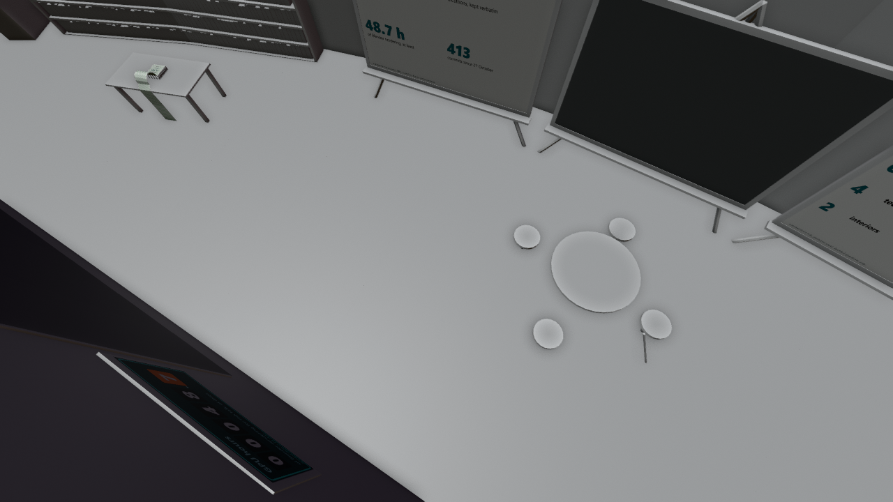

# Museum room 6: making of

*Preview with simple shading. Grey surfaces on panels mark images that are not included (see below).*

Making of: easels with early and late states of the station, a board of decisions, the numbers behind the talk (rendering hours, dictated words, prompts), a stack of fanfold paper, a screen with the Blender window, the plans as they changed, what went wrong, and a door that carries the rebound graphic.

## Files

- [museum_room_6.blend](museum_room_6.blend) (3.4 MB): open in Blender 5.2 or newer (files saved in 5.2 do not open in 4.x; use the .glb there). The collection `museum_room_6` can be appended or linked into another scene; reuse beyond viewing and study needs the licence, which is still pending (see [LICENSE](../../LICENSE)).
- [museum_room_6.glb](museum_room_6.glb) (3.8 MB): glTF binary for other tools and game engines; text objects and some materials are simplified by the exporter.

## Using it

- Positions are the station's coordinates in metres, so modules fit together again when you link several of them; [../station.blend](../station.blend) links all of them. Object origins sit at the station centre, not at the room: press Home (View All) to find the module, and use Object > Set Origin > Origin to Geometry before you move a part on its own.
- Light and sky are in [environment](../environment/README.md); link it as well, otherwise the module renders unlit.
- Object names are German, as the scene was built with German names; [manifest.json](../manifest.json) lists every object.

## What is inside

| Collection | Objects |
|---|---|
| `museum_room_6.room_6` | 104 |

8 images are packed into the .blend file.

## Left out on purpose

These are works by others or illustrations we cannot license. Materials keep their image slot: a picture saved as `station/withheld/<file name>` appears in place. Left-out objects are empties named `Withheld <name>` at the same place.

- `credits.png`: shows the Blender and Poly Haven logos (trademarks)
- `first_ride.png`: small renders, one of them may show Borgi figures, left out until cleared
- `mistakes_story.png`: small renders, one of them may show Borgi figures, left out until cleared
- `plan_story.png`: contains a small photograph by others (inset in the first floor plan)
- 11 objects: Borgi cut-out figure: shape and image by Gerrit Hansen, which we cannot license
