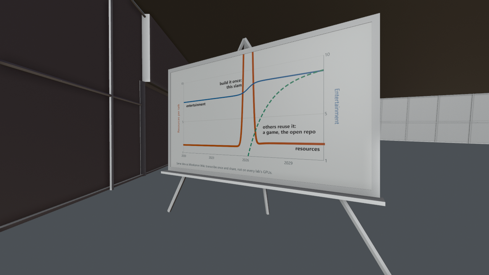

# Museum centre room (the hall between the rooms): the better curve

*Preview with simple shading. Grey surfaces on panels mark images that are not included (see below).*

The centre room of the museum: the better curve, where a focused effort is followed by open reuse. The globe that stood in the middle of this room in the talk is not included. The "better curve" is the second half of the rebound graphic: a short, focused peak of effort followed by open reuse, instead of a permanent rise.

## Files

- [museum_room_7.blend](museum_room_7.blend) (0.3 MB): open in Blender 5.2 or newer (files saved in 5.2 do not open in 4.x; use the .glb there). The collection `museum_room_7` can be appended or linked into another scene; reuse beyond viewing and study needs the licence, which is still pending (see [LICENSE](../../LICENSE)).
- [museum_room_7.glb](museum_room_7.glb) (0.2 MB): glTF binary for other tools and game engines; text objects and some materials are simplified by the exporter.

## Using it

- Positions are the station's coordinates in metres, so modules fit together again when you link several of them; [../station.blend](../station.blend) links all of them. Object origins sit at the station centre, not at the room: press Home (View All) to find the module, and use Object > Set Origin > Origin to Geometry before you move a part on its own.
- Light and sky are in [environment](../environment/README.md); link it as well, otherwise the module renders unlit.
- Object names are German, as the scene was built with German names; [manifest.json](../manifest.json) lists every object.

## What is inside

| Collection | Objects |
|---|---|
| `museum_room_7.room_7` | 3 |

1 image is packed into the .blend file.
