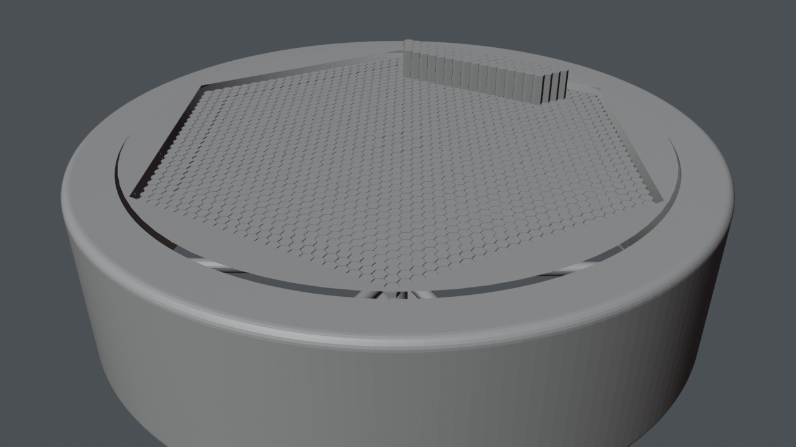

# Station structure: ring shell, spokes, axis, collector, hub hull

*Preview with simple shading. Grey surfaces on panels mark images that are not included (see below).*

The structure of the rotating station: the ring with its floor, ceiling and ribbed glass roof, six spokes with ladders and the bearing collar, the axis tube with the distribution mirror, the collector of honeycomb cells that faces the sun, the outer hull of the hub with windows, radiators and antennas, and the docking area with the hangar band.

## Files

- [station_structure.blend](station_structure.blend) (1.5 MB): open in Blender 5.2 or newer (files saved in 5.2 do not open in 4.x; use the .glb there). The collection `station_structure` can be appended or linked into another scene; reuse beyond viewing and study needs the licence, which is still pending (see [LICENSE](../../LICENSE)).
- [station_structure.glb](station_structure.glb) (8.2 MB): glTF binary for other tools and game engines; text objects and some materials are simplified by the exporter.

## Using it

- Positions are the station's coordinates in metres, so modules fit together again when you link several of them; [../station.blend](../station.blend) links all of them. Object origins sit at the station centre, not at the room: press Home (View All) to find the module, and use Object > Set Origin > Origin to Geometry before you move a part on its own.
- Light and sky are in [environment](../environment/README.md); link it as well, otherwise the module renders unlit.
- Object names are German, as the scene was built with German names; [manifest.json](../manifest.json) lists every object.

## What is inside

| Collection | Objects |
|---|---|
| `station_structure.axis` | 3 |
| `station_structure.docking` | 2 |
| `station_structure.hub_hull` | 5 |
| `station_structure.collector` | 3 |
| `station_structure.spokes` | 8 |
| `station_structure.ring_shell` | 5 |

## From Poly Haven (not included)

Put these files into `station/textures/polyhaven/<asset>/` (download from the linked page, see [../../assets/README.md](../../assets/README.md)):

- [metal_plate_02](https://polyhaven.com/a/metal_plate_02): `metal_plate_02_nor_gl_1k.jpg`
- [metal_plate_02](https://polyhaven.com/a/metal_plate_02): `metal_plate_02_rough_1k.jpg`
